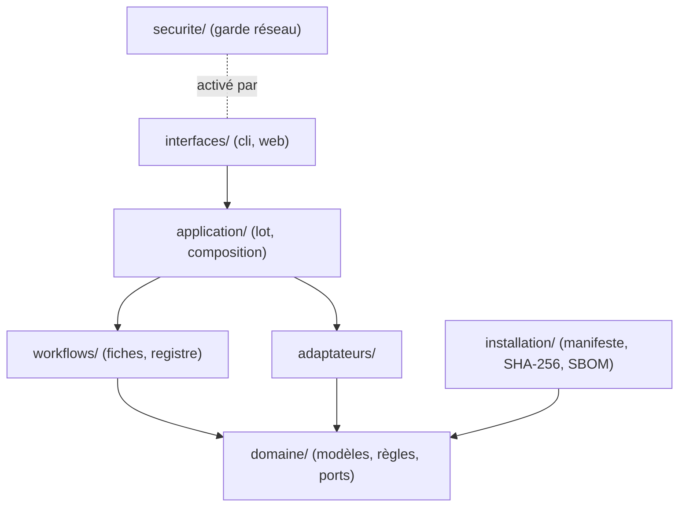
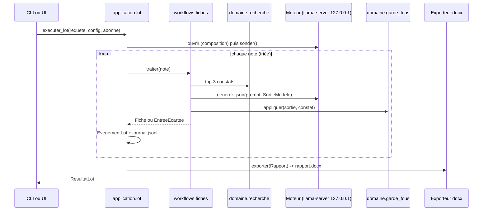
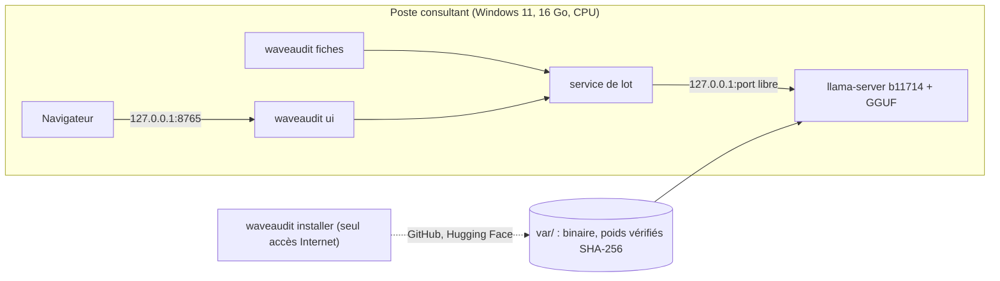

# Architecture Spine — WaveAudit POC

## Design Paradigm

Hexagonal. Le **domaine** (modèles, règles pures) et les **workflows** (pipeline par élément) ne connaissent que des **ports** (`typing.Protocol`). Les **adaptateurs** (moteur HTTP, llama-server, catalogue YAML, notes sur disque, export Word) implémentent ces ports. Une seule **racine de composition** les assemble. Les **interfaces** (CLI, web) n'appellent que le service de lot de l'**application**.

Workflow `fiches` = pipeline par note : `lire → rechercher → adapter → controler`, puis `assembler` sur le lot. Le workflow CERT se branchera plus tard comme un second workflow derrière les mêmes ports.



## Invariants & Rules

Les formes exactes (modèles, ports, configuration, manifeste, signatures) sont dans `contrats.md`, annexe normative : les § cités ci-dessous y renvoient.

### AD-0 — Socle commun livré seul et en premier

- **Binds:** all
- **Prevents:** des fichiers partagés (`pyproject.toml`, `uv.lock`, `conftest.py`, modèles, ports, configuration) réécrits de façon incompatible par des stories parallèles.
- **Rule:**
  - La story `socle` est exécutée, intégrée et vérifiée (suite verte sur `main`) avant toute autre. Elle crée :
    - `pyproject.toml` (toutes les dépendances de la table Stack, épinglées ; `addopts = "-m 'not slow' --allow-hosts=127.0.0.1,::1"` ; ruff) et `uv.lock` ;
    - l'arborescence avec les `__init__.py` ;
    - `domaine/modeles.py`, `ports.py`, `erreurs.py` et `configuration.py` ;
    - `application/config.py` ;
    - `config/waveaudit.toml` et `config/artefacts.toml` ;
    - `workflows/registre.py` (protocole) ;
    - `tests/conftest.py`, `tests/faux_moteur.py` et `tests/unitaires/test_architecture.py`.
  - Les stories suivantes ne modifient pas ces fichiers. Un manque (champ, dépendance, fixture) s'arrête et se signale.
  - Elles ajoutent leurs propres modules, et leurs tests sous `tests/unitaires/test_<module>.py` ou `tests/e2e/test_<sujet>.py`.

### AD-1 — Sens des dépendances

- **Binds:** all
- **Prevents:** du HTTP, du YAML ou du docx glissé dans la logique métier, qui rendrait le moteur non interchangeable et les tests dépendants du réseau.
- **Rule:**
  - Le sens suit le diagramme : `domaine/` et `workflows/` n'importent que la stdlib, `pydantic` et `domaine`. Exception : `domaine/cvss31.py`, seul importateur de `cvss`.
  - Imports réservés (analyse limitée à `src/waveaudit/`) :
    - `httpx` : `adaptateurs/` et `installation/telechargement.py` ;
    - `psutil`, `yaml`, `docx` : `adaptateurs/` ;
    - `fastapi`, `jinja2`, `multipart` : `interfaces/web/` ;
    - `uvicorn`, `typer` : `interfaces/cli.py`.
  - `installation` est importé seulement par `application/` et `interfaces/cli.py`.
  - Seul `application/composition.py` instancie des adaptateurs.
  - `tests/unitaires/test_architecture.py` (analyse des `import` par `ast`) fait respecter ces règles ; `tests/` n'y est pas soumis.

### AD-2 — Un seul service de lot pour la CLI et l'UI [ADOPTED]

- **Binds:** CAP-7, CAP-8, CAP-12
- **Prevents:** deux implémentations du pipeline qui divergent entre la CLI et l'UI, ou des identifiants de lot différents.
- **Rule:**
  - Point d'entrée unique : `application.lot.executer_lot(requete: RequeteLot, config: Configuration, abonne) -> ResultatLot` (contrats §1, §9).
  - La CLI l'appelle directement. L'UI l'exécute dans un thread, un lot à la fois (HTTP 409 sinon).
  - `id_lot` vient de `nouvel_id_lot` et sert partout (`var/entrees/`, `var/sorties/`, routes).
  - L'avancement passe exclusivement par `EvenementLot`.

### AD-3 — Port moteur et adaptateur compatible OpenAI [ADOPTED]

- **Binds:** CAP-4, CAP-9
- **Prevents:** un couplage au moteur local, des formats de requête différents, ou une classification d'erreurs divergente.
- **Rule:**
  - Port `Moteur`, avec `sonder()` et `generer_json(...)` (contrats §3). Seul `adaptateurs/moteur_openai.py` fait ces appels HTTP.
  - `base_url` se termine toujours par `/v1` et utilise `127.0.0.1`, jamais `localhost`.
  - `httpx.Client(trust_env=False)` : le proxy d'entreprise est ignoré à l'exécution.
  - `SortieInvalide` est levée seulement pour un contenu non JSON ou qui n'est pas un objet. `MoteurInjoignable` est levée pour une connexion refusée, un timeout ou un statut différent de 200.
  - L'adaptateur ne valide pas le schéma.

### AD-4 — Contrat de sortie du modèle [ADOPTED]

- **Binds:** CAP-4, CAP-5
- **Prevents:** qu'un SLM de moins de 2B invente des références, un format ou un vecteur.
- **Rule:**
  - Un appel par fiche, avec `response_format` json_schema = `schema_sortie(longueur_max_rubrique)` (contrats §1) : 4 rubriques et métriques CVSS en enums. Aucun champ de références.
  - Le prompt suit contrats §8 : balises `<constat>` et `<note>` dans le dernier message `user`, corps tronqué à `taille_max_note`.
  - Le préfixe système propre au modèle (`/no_think` pour Qwen3) arrive par `Ports.prefixe_systeme`.

### AD-5 — Garde-fous déterministes après le modèle

- **Binds:** CAP-5
- **Prevents:** une référence inventée, un score incohérent ou une rubrique vide dans la fiche finale.
- **Rule:** `domaine/garde_fous.appliquer` s'applique à chaque fiche, repli compris, dans l'ordre de contrats §6 :
  1. références copiées du constat type ;
  2. retrait des jetons de type référence hors constat (insensible à la casse, motifs CWE, CVE, CAPEC, WSTG, OWASP, ANSSI, CERT-FR et URL) ;
  3. métriques invalides → vecteur par défaut ;
  4. rubrique trop courte → texte du constat type.
  - Score et sévérité viennent uniquement de `domaine/cvss31.evaluer`.
  - `statut = a_revoir` si et seulement si `motifs` n'est pas vide.

### AD-6 — Repli et continuité du lot

- **Binds:** CAP-1, CAP-4, CAP-7
- **Prevents:** un lot interrompu par une seule note, ou des comportements d'erreur différents selon l'interface.
- **Rule:**
  - `SortieInvalide`, y compris une rubrique absente vue par le workflow, déclenche un seul nouvel essai, puis le repli `repli_sortie_invalide`.
  - `MoteurInjoignable` en cours de lot déclenche un repli immédiat (`repli_moteur`). Le repli reprend le constat type, avec le statut `a_revoir`.
  - Une note invalide donne une `EntreeEcartee` `non_traitee`.
  - Score BM25 maximal `<= 0` : `EntreeEcartee` `non_rattachee`, sans appel au modèle (pas de génération ex nihilo).
  - Seules la sonde initiale en échec, une entrée ou une configuration invalide, et `ConnexionInterdite` arrêtent le lot.

### AD-7 — Recherche lexicale déterministe

- **Binds:** CAP-3
- **Prevents:** une dépendance à un modèle d'embedding, ou plusieurs classements concurrents.
- **Rule:**
  - `domaine/recherche.classer`, BM25 sans dépendance externe, avec la tokenisation, la pondération par répétition des champs et l'IDF positif de contrats §7.
  - La requête n'inclut jamais `constat_attendu` ni `actif`.
  - Le constat retenu est le premier candidat ; les 3 premiers vont dans `Tracabilite.candidats`.

### AD-8 — Résultats d'un lot et événements

- **Binds:** CAP-6, CAP-7, CAP-8, CAP-12
- **Prevents:** un export qui relit autre chose que le rapport validé, ou plusieurs écrivains du journal.
- **Rule:**
  - Chaque lot écrit dans `var/sorties/<id_lot>/` : `fiches.json` (= `Rapport`), `journal.jsonl` et `rapport.docx`.
  - `application/lot.py` est le seul émetteur d'`EvenementLot` et le seul écrivain de `journal.jsonl` ; il écrit avant d'appeler l'abonné.
  - L'exporteur ne lit qu'un `Rapport`.
  - Éléments triés par nom de note (`casefold`) ; noms de fichiers seulement, jamais de chemin absolu, dans la traçabilité et le journal.

### AD-9 — Hors ligne vérifiable

- **Binds:** CAP-7, CAP-8, CAP-11, CAP-12
- **Prevents:** un appel sortant introduit par une dépendance (télémétrie, CDN, proxy) sans que rien le détecte.
- **Rule:**
  - API `securite/garde_reseau` (contrats §12). Les commandes `fiches`, `ui` et `banc` chargent la configuration, puis exécutent tout le reste dans `with garde(config.reseau.hotes_autorises)`.
  - `ConnexionInterdite` n'hérite pas d'`OSError`, n'est jamais convertie et donne le code 4.
  - Seule la commande `installer` s'exécute sans garde.
  - Côté tests : pytest-socket `--allow-hosts=127.0.0.1,::1`, jamais `--disable-socket`. `tests/e2e/test_hors_ligne.py` exécute un lot CLI et un lot UI (`TestClient`) sous `garde(...)` et exige `tentatives() == []`.
  - Aucune URL externe dans les gabarits ni dans les fichiers statiques (test dédié).

### AD-10 — Faux moteur de test [ADOPTED]

- **Binds:** CAP-4, CAP-5, CAP-7, CAP-8, CAP-9, CAP-11, CAP-12
- **Prevents:** des tests qui exigent un vrai modèle, ou un bouchon inventé par chaque story.
- **Rule:**
  - Un seul faux moteur, `tests/faux_moteur.py`, exposé par la fixture **fabrique** `faux_moteur(scenario)`, avec ses scénarios et la fixture `config_test` (contrats §13).
  - Aucun test n'écrit dans le `var/` du dépôt.
  - Seuls les tests marqués `slow` lancent le vrai llama-server ; ils sont sautés si les poids sont absents.

### AD-11 — Cycle de vie de llama-server [ADOPTED]

- **Binds:** CAP-9, CAP-10, CAP-12
- **Prevents:** des processus orphelins, une écoute réseau hors boucle locale, ou deux propriétaires du moteur.
- **Rule:**
  - Seul `application/composition.ouvrir` démarre le moteur (contrats §9), une fois par lot, CLI et UI comprises. `pid_moteur` est publié dans `lot_demarre`.
  - `adaptateurs/llama_server.LlamaServer` (contrats §10) :
    - écoute sur `127.0.0.1` et un port libre ;
    - reçoit toujours `-c` et `-t` explicitement (sans contexte borné, le cache KV fait exploser la RAM) ;
    - est rattaché à un Job Object `KILL_ON_JOB_CLOSE` par `OpenProcess` ;
    - écrit sa sortie dans `var/journaux/`, jamais dans un tube non lu.
  - Le modèle de repli est choisi si la RAM disponible est sous `ram_min_defaut_go`.

### AD-12 — Manifeste des artefacts et installation

- **Binds:** CAP-10, CAP-11
- **Prevents:** des poids ou un binaire non vérifiés, ou des chemins codés en dur.
- **Rule:**
  - `config/artefacts.toml` est un tableau `[[artefact]]` (contrats §11). Rôles :
    - `moteur` : llama-server b11714 ;
    - `modele_defaut` : granite-4.0-1b ;
    - `modele_repli` : MiniCPM5-1B ;
    - `candidat` : Qwen3-1.7B (`/no_think`), Qwen3.5-0.8B.
  - `waveaudit installer` installe le moteur, le défaut et le repli ; `--candidats` ajoute les candidats. Les fichiers passent par `.part`, puis sont vérifiés (taille et SHA-256) et renommés. En cas d'écart : suppression et code 5.
  - Les tests utilisent `httpx.MockTransport`.
  - Les chemins ne s'obtiennent que par `installation.manifeste`.
  - `waveaudit sbom` écrit `var/sbom.cdx.json` en analysant l'interpréteur du venv.

### AD-13 — Configuration

- **Binds:** all
- **Prevents:** des réglages lus à plusieurs endroits, ou des clés et défauts qui divergent.
- **Rule:**
  - Clés, types et défauts exacts : contrats §2, avec `extra="forbid"`.
  - Le modèle est dans `domaine/configuration.py`, le chargement dans `application/config.py` (`charger_configuration`, `racine_projet`).
  - Surcharge par `waveaudit.local.toml` (ignoré par git) puis par `--config`.
  - Aucun `os.environ` ni lecture de configuration ailleurs.
  - Chemins relatifs résolus contre `racine_projet()`, jamais contre `cwd`.

### AD-14 — Thème et bandeau

- **Binds:** CAP-6, CAP-7, CAP-8
- **Prevents:** une charte Wavestone qui fuit dans le dépôt, un export qui échoue sans elle, ou une sortie sans bandeau.
- **Rule:**
  - Le rapport Word suit contrats §17 : intitulés exacts, bandeau en en-tête et en pied, annexe des entrées écartées. Il utilise `theme-prive/` s'il existe, le thème générique sinon.
  - Le bandeau exact `Démonstration — données fictives` figure aussi sur chaque page web et en première et dernière ligne de la sortie CLI de `fiches`.

### AD-15 — Extension par workflow

- **Binds:** CAP-7 (et le futur workflow CERT)
- **Prevents:** une refonte au moment d'ajouter le workflow de réponse à incident, ou un workflow qui contourne AD-1.
- **Rule:**
  - `workflows/registre.REGISTRE` associe un nom à une fabrique `(Configuration, Ports) -> Workflow` (contrats §5). Le workflow reçoit ses ports et n'instancie rien.
  - `traiter` ne fait aucune entrée-sortie et n'émet aucun événement.
  - Seul `fiches` est enregistré. Un workflow vit dans `workflows/<nom>/` sans dépendre d'un autre.

### AD-16 — Formes partagées figées

- **Binds:** CAP-1 à CAP-12
- **Prevents:** deux stories qui codent `Fiche`, `EvenementLot`, `Configuration` ou un port avec des champs différents, ou des identifiants de constat inventés séparément pour le catalogue et pour les notes (CAP-3 tomberait à 0).
- **Rule:**
  - Les modèles, ports, erreurs, codes retour, format de manifeste, faux moteur, API web et CLI sont ceux de `contrats.md`. Les identifiants de constat et de notes sont ceux de contrats §16.
  - Toute divergence nécessaire passe par une mise à jour de `contrats.md` dans une story dédiée, jamais par une variante locale.

### AD-17 — Workflow incident (CERT), service dédié

- **Binds:** SPEC-waveaudit-cert CAP-1 à CAP-7
- **Prevents:** une généralisation forcée du protocole `Workflow` des fiches ; un second moteur, garde réseau, écrivain de journal ou format d'événements ; des stories parallèles qui se rencontrent sans contrat figé.
- **Rule:**
  - Le CERT a ses propres formes, ports et service (contrats §21) : `domaine/incident.py`, `workflows/incident/` et `application/incident.executer_incident`. Il n'est pas inscrit dans `REGISTRE`.
  - Il réutilise sans les dupliquer : le port `Moteur`, la composition, le garde réseau, `EvenementLot` (sans nouveau `TypeEvenement`), `nouvel_id_lot` et les conventions.
  - Seule la story C1 modifie le code existant du MVP : ajouts aux fichiers AD-0 (formes, ports, configuration, faux moteur) et deux extractions sans changement de comportement, `application/journal.JournalLot` (tiré de `lot.py` ; il devient l'unique écrivain de `journal.jsonl` au sens d'AD-8) et `composition.ouvrir_moteur_incident` (tiré d'`ouvrir`). Les autres stories CERT n'ajoutent que des fonctions ou une commande nouvelles (`creer_ports_incident`, commande `incident`).
  - La création des ports (`creer_ports_incident`, sans processus) est séparée de l'ouverture du moteur, ouvert seulement s'il y a au moins une détection.
  - Conditions des règles, champs normalisés, chronologie de démo et schéma de l'oracle sont normatifs dans `formats-incident.md`. C1 les traduit en constantes (`domaine/incident.py`) et en fixture (`tests/donnees/incident/canoniques.yaml`) : c'est là que C2, C3 et C4 se rencontrent.
  - L'oracle `donnees/demo/incident-attendu.yaml` est hors du dossier lu et ne se régénère jamais depuis une sortie du programme.
  - La détection, les indicateurs et la chronologie sont déterministes ; le SLM ne rédige que le récit.

## Consistency Conventions

| Concern | Convention |
| --- | --- |
| Langue | Identifiants, messages, journaux et documents en français, sans accents dans les identifiants Python. Les termes techniques consacrés restent tels quels (`schema`, `token`). |
| Nommage | Modules `snake_case`, classes `PascalCase`, ports au nom du rôle (`Moteur`, `Catalogue`, `SourceNotes`, `Exporteur`), adaptateurs suffixés par la techno (`MoteurOpenAI`, `CatalogueYaml`). |
| Identifiants de constat | `FAMILLE-SUJET[-PRECISION]` en majuscules ASCII avec tirets, préfixe = famille ; liste minimale figée (contrats §16). |
| Catalogue | Un fichier par famille : `donnees/catalogue/<famille>.yaml` (`web`, `ad`, `infra`, `config`, `crypto`, `autre`), une liste de constats ; schéma `ConstatType` de `formats.md`. |
| Notes de démonstration | `donnees/demo/notes/NN-<id sans préfixe, minuscules>.md` (`01` à `20`), `constat_attendu` pris dans contrats §16. |
| Erreurs | Hiérarchie `ErreurWaveAudit` (contrats §4), aucune n'hérite d'`OSError` ; aucune exception nue ne sort d'un adaptateur. |
| Codes retour CLI | `0` lot terminé (même avec `a_revoir`), `2` entrée ou configuration invalide, `3` moteur injoignable, `4` connexion interdite ou erreur interne, `5` empreinte invalide (contrats §4). |
| Statuts | `ok`, `a_revoir`, `non_traitee`, `non_rattachee` (enum `Statut`). |
| Dates | ISO 8601 avec fuseau (`datetime.now().astimezone()`). |
| Fichiers | `pathlib`, UTF-8 explicite (`utf-8-sig` en lecture des notes), aucun chemin absolu codé en dur ; tout l'état d'exécution sous `var/` (ignoré par git) ; console reconfigurée en UTF-8. |
| Journalisation | `logging` stdlib pour le diagnostic ; `journal.jsonl` pour les événements métier (AD-8). |
| Tests | `tests/unitaires/` et `tests/e2e/`, données de test sous `tests/donnees/`, marqueur `slow` exclu par défaut (`-m "not slow"`), aucun réseau ni vrai modèle hors `slow`. Pour chaque story, les tests ciblés passent puis `ruff check` et `ruff format --check`. |

## Stack

| Name | Version |
| --- | --- |
| Python | 3.12.* (uv) |
| llama.cpp `llama-server` (`llama-b11714-bin-win-cpu-x64.zip`, 19662606 o, sha256 `f78eded047061a3f86372db426797400a2f1bb0ec37868d5927dd820eb3386c0`) | b11714 |
| Défaut : `ibm-granite/granite-4.0-1b-GGUF` `granite-4.0-1b-Q4_K_M.gguf` (1023645440 o, sha256 `22ec0f9cc99a90185312de3c882c84e7bd6789bdd050389844380a01a831d7f1`, Apache-2.0) | commit b27c2fe3f211b7f44e80fa620177aea371099aaa |
| Repli : `openbmb/MiniCPM5-1B-GGUF` `MiniCPM5-1B-Q4_K_M.gguf` (688065920 o, sha256 `81b64d05a23b17b34c475f42b3e72fbde62d4b92cc34541f7a8031d0752deafa`, Apache-2.0) | commit 3d55fac80935ae6456986ad2384b5cbcc4d6c948 |
| Candidat : `unsloth/Qwen3-1.7B-GGUF` `Qwen3-1.7B-Q4_K_M.gguf` (1107409472 o, sha256 `b139949c5bd74937ad8ed8c8cf3d9ffb1e99c866c823204dc42c0d91fa181897`, Apache-2.0) | commit d7f544eead698dbd1f15126ef60b45a1e1933222 |
| Candidat : `unsloth/Qwen3.5-0.8B-GGUF` `Qwen3.5-0.8B-Q4_K_M.gguf` (532517120 o, sha256 `bd258782e35f7f458f8aced1adc053e6e92e89bc735ba3be89d38a06121dc517`, Apache-2.0) | commit 6ab461498e2023f6e3c1baea90a8f0fe38ab64d0 |
| pydantic | 2.14.1 |
| httpx | 0.28.1 |
| fastapi | 0.143.3 |
| uvicorn | 0.54.0 |
| jinja2 | 3.1.6 |
| python-multipart | 0.0.32 |
| typer | 0.27.3 |
| pyyaml | 6.0.3 |
| python-docx | 1.2.0 |
| cvss | 3.6 |
| psutil | 7.2.2 |
| pytest | 9.1.1 |
| pytest-socket | 0.8.1 |
| cyclonedx-bom | 7.5.0 |
| ruff | 0.17.1 |

## Structural Seed

```text
waveaudit/
  pyproject.toml            # package src/, script `waveaudit`, deps épinglées, addopts pytest
  config/
    waveaudit.toml          # défauts (moteur, reseau, recherche, export, ui)
    artefacts.toml          # manifeste : llama-server, modèles, SHA-256, licences
  donnees/
    catalogue/<famille>.yaml
    demo/notes/NN-<sujet>.md
  src/waveaudit/
    domaine/                # modeles.py, ports.py, erreurs.py, configuration.py, recherche.py, garde_fous.py, cvss31.py
    workflows/              # registre.py, fiches/ (pipeline.py, prompt.py)
    adaptateurs/            # moteur_openai.py, llama_server.py, catalogue_yaml.py, notes_fichiers.py, export_docx.py, theme_generique.py, memoire_psutil.py
    application/            # config.py, composition.py, lot.py, banc.py
    installation/           # manifeste.py, telechargement.py, sbom.py
    securite/               # garde_reseau.py
    interfaces/             # cli.py, web/ (app.py, templates/, static/)
  tests/
    conftest.py  faux_moteur.py
    unitaires/  e2e/  donnees/
  var/                      # ignoré : moteur/, modeles/, sorties/, entrees/, journaux/
  theme-prive/              # ignoré : modele.docx, theme.toml
```





CLI, routes UI, banc et leurs formats : contrats §18 à §20.

## Capability → Architecture Map

| Capability / Area | Lives in | Governed by |
| --- | --- | --- |
| CAP-1 notes | `adaptateurs/notes_fichiers.py`, `domaine/modeles.py` | AD-6, `formats.md` |
| CAP-2 catalogue | `donnees/catalogue/`, `adaptateurs/catalogue_yaml.py`, `waveaudit catalogue verifier` | AD-16, contrats §15-16 |
| CAP-3 recherche | `domaine/recherche.py` | AD-7 |
| CAP-4 adaptation | `workflows/fiches/`, `adaptateurs/moteur_openai.py` | AD-3, AD-4, AD-6 |
| CAP-5 garde-fous | `domaine/garde_fous.py` | AD-5 |
| CAP-6 Word | `adaptateurs/export_docx.py` | AD-8, AD-14 |
| CAP-7 CLI | `interfaces/cli.py`, `application/lot.py` | AD-2, AD-6, AD-8, codes retour |
| CAP-8 UI | `interfaces/web/` | AD-2, AD-9 |
| CAP-9 moteur interchangeable | `application/config.py`, `adaptateurs/moteur_openai.py` | AD-3, AD-11, AD-13 |
| CAP-10 installation | `installation/`, `config/artefacts.toml` | AD-12 |
| CAP-11 hors ligne + SBOM | `securite/garde_reseau.py`, `tests/e2e/test_hors_ligne.py`, `installation/sbom.py` | AD-9, AD-12 |
| CAP-12 banc | `application/banc.py`, `adaptateurs/memoire_psutil.py` | AD-8, AD-11, contrats §20 |
| Socle partagé | `domaine/`, `config/`, `tests/conftest.py`, `tests/faux_moteur.py` | AD-0, AD-16 |

## Deferred

- Choix final du modèle et réglage du prompt : sur l'EliteBook, hors nuit, avec la méthode de `slm-quality-bench`. Le manifeste et la configuration suffisent à en changer.
- Valeurs fines de `-c`, `-t` et du seuil RAM : réglées au banc réel (CAP-12). Défauts de départ : `ctx` 4096, 4 threads, `ram_min_defaut_go` 4,5.
- Workflow CERT : spécifié dans SPEC-waveaudit-cert et AD-17, développé après le MVP.
- Installateur Windows packagé (Inno Setup), variante archive hors ligne des poids : après les retours des testeurs.
- Authentification vers un LLM interne Wavestone : à définir quand l'endpoint existera ; `Configuration.moteur.cle_api` est seulement prévue.
- Contenu de la charte Wavestone : hors dépôt (AD-14).
- CI GitHub : non requise pour le POC ; la suite locale fait foi.
- Risque à lever au premier test `slow` : le comportement de `--jinja` avec `response_format` json_schema sur granite-4.0-1b et MiniCPM5-1B (gabarit de chat, grammaire). En cas d'échec, une option `moteur.mode_json = "json_object"` est à ajouter par mise à jour de `contrats.md`.
- Pas d'authentification sur l'UI locale au-delà des contrôles Host/Origin (contrats §18) : suffisant pour des données fictives, à revoir au pilote.
